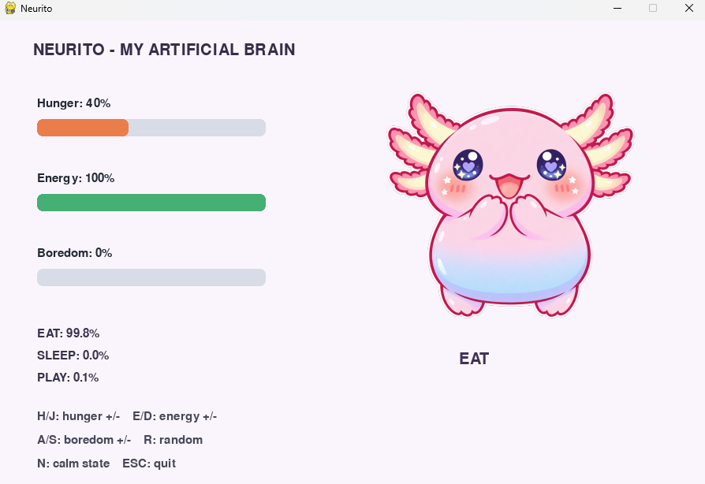
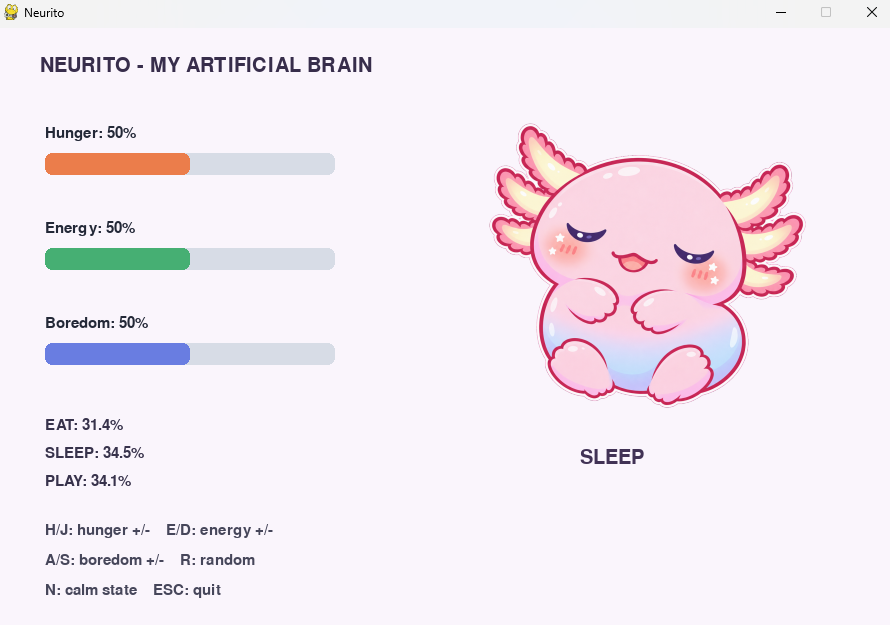

# Neurito - Mi Cerebro Artificial

Simulador interactivo basado en una red neuronal desde cero usando NumPy, donde una mascota virtual evalúa sus necesidades para tomar decisiones.

## 1. Experimentos Realizados

* **Mantener dos necesidades fijas y variar la tercera:** 
  Al fijar la energía al 100% y el aburrimiento al 0%, y variar únicamente el hambre, la red neuronal reacciona con alta sensibilidad. Incluso con el hambre al 40%, la probabilidad de la acción "EAT" se dispara al 99.8%, demostrando que el modelo aprendió a priorizar el déficit más crítico según la política sintética.
* **Prioridades casi iguales:** 
  Al configurar el hambre, la energía y el aburrimiento exactamente al 50%, la función Softmax distribuye las probabilidades de forma casi equitativa (ej. EAT: 31.4%, SLEEP: 34.5%, PLAY: 34.1%). El modelo no encuentra un patrón dominante, por lo que la decisión final (Dormir, en este caso) se toma por un margen de diferencia minúsculo.
* **Modificación de la capa oculta:** 
  * *3 neuronas:* El modelo sufre de *underfitting*. La pérdida no logra bajar a niveles óptimos y la precisión disminuye porque la red pierde capacidad para abstraer patrones complejos.
  * *10 a 20 neuronas:* La pérdida converge más rápido en menos épocas y la precisión frente a la política sintética sube. Sin embargo, más de 20 neuronas para este problema de 3 variables resulta en un gasto computacional innecesario sin mejoras de precisión perceptibles.
* **Cambio de épocas y tasa de aprendizaje:** 
  Al reducir la tasa de aprendizaje (ej. 0.05) el entrenamiento se vuelve mucho más estable, pero requiere compensarse aumentando las épocas (ej. 2500) para que el modelo logre converger al mínimo de pérdida. Una tasa muy alta causa saltos erráticos (inestabilidad), y muy pocas épocas dejan el entrenamiento estancado antes de aprender.
* **Implementación de una cuarta acción (Ej. Mimar):**
  A nivel de datos requeriría:
  1. Modificar la matriz de entrada `X` para tener 4 columnas (una nueva variable aleatoria).
  2. Modificar la lógica de las etiquetas (`targets`) para incluir una condición donde esta 4ta acción sea prioritaria.
  3. Cambiar los pesos de salida `W2` a tamaño `(ocultas, 4)` y el sesgo `b2` a `(1, 4)`.

## 2. Explicación de Resultados

**1. ¿En qué se diferencian pesos y sesgos?**
Los pesos ($W$) determinan la fuerza o importancia de la conexión entre dos neuronas; multiplican la entrada para definir cuánto afecta esa variable al resultado. Los sesgos ($b$) son valores constantes que se suman para desplazar el umbral de activación, permitiendo que la neurona se dispare incluso si los valores de entrada multiplicados por los pesos son cercanos a cero.

**2. ¿Por qué el cansancio es 1 - energía?**
Porque el sistema utiliza valores normalizados en un rango de 0 a 1 para representar porcentajes. El cansancio y la energía son estados opuestos y complementarios; si la energía está al 0.8 (80%), el nivel de desgaste lógico obligatoriamente es el remanente matemático para completar el 100%, es decir, $1 - 0.8 = 0.2$.

**3. ¿Qué hace ReLU y qué hace Softmax?**
* **ReLU:** Elimina los valores negativos convirtiéndolos en 0 y deja pasar los positivos. Esto introduce "no linealidad" en la red, permitiéndole aprender relaciones complejas en lugar de trazar simples líneas rectas.
* **Softmax:** Toma los valores crudos de la capa de salida y los convierte en una distribución de probabilidades estructurada (porcentajes que suman 100%), permitiendo clasificar de manera clara cuál es la acción ganadora.

**4. ¿Por qué una precisión alta puede ser engañosa?**
Porque si los datos sintéticos de entrenamiento están desbalanceados (por ejemplo, si el 90% de las veces la política dicta que la mascota debe estar "Neutral"), un modelo deficiente podría simplemente aprender a predecir "Neutral" todo el tiempo. Obtendría un 90% de precisión matemática, pero en la práctica sería incapaz de predecir correctamente cuándo debe comer o jugar.

## 3. Anexos y Evidencias

A continuación, se presentan las capturas del simulador evidenciando los resultados de los experimentos:

**Experimento 1: Necesidad crítica (EAT al 99.8%)**

**Experimento 2: Prioridades iguales (Incertidumbre)**

**Nota sobre modificaciones en el código:**
Para llevar a cabo estos experimentos, se realizaron alteraciones directas en el archivo `main.py`. Puedes revisar el código fuente en este repositorio para verificar los cambios aplicados en la inicialización de la red neuronal (capa oculta de 10 neuronas) y en el ciclo de entrenamiento (2500 épocas y tasa de aprendizaje de 0.05).