# Neurito - Proyecto de Cerebro Artificial Evolutivo

**Nota para la revisión (Profesor):**  
Este repositorio documenta la evolución completa del proyecto "Neurito", dividido en tres grandes fases. Cada fase de desarrollo y experimentación se trabajó en su propia rama independiente (`main`, `feature/neurito-salto`, y `feature/neurito-laberinto`) y finalmente se unificaron aquí. 

Puedes desplazarte hacia abajo para leer la documentación, las pruebas de código y las evidencias gráficas de cada una de las tres etapas:
1. **Neurito 1.0:** Decisiones de Necesidades Básicas.
2. **Neurito 2.0:** Aprendizaje de Saltos.
3. **Neurito 3.0:** Busca Comida en un Laberinto.

---

## Neurito 1.0 - Decisiones de Necesidades Básicas
Simulador interactivo basado en una red neuronal desde cero usando NumPy, donde una mascota virtual evalúa sus necesidades para tomar decisiones.

### 1. Experimentos Realizados
- **Mantener dos necesidades fijas y variar la tercera:** Al fijar la energía al 100% y el aburrimiento al 0%, y variar únicamente el hambre, la red neuronal reacciona con alta sensibilidad. Incluso con el hambre al 40%, la probabilidad de la acción "EAT" se dispara al 99.8%, demostrando que el modelo aprendió a priorizar el déficit más crítico según la política sintética.
- **Prioridades casi iguales:** Al configurar el hambre, la energía y el aburrimiento exactamente al 50%, la función Softmax distribuye las probabilidades de forma casi equitativa (ej. EAT: 31.4%, SLEEP: 34.5%, PLAY: 34.1%). El modelo no encuentra un patrón dominante, por lo que la decisión final (Dormir, en este caso) se toma por un margen de diferencia minúsculo.
- **Modificación de la capa oculta:**
  - *3 neuronas:* El modelo sufre de underfitting. La pérdida no logra bajar a niveles óptimos y la precisión disminuye porque la red pierde capacidad para abstraer patrones complejos.
  - *10 a 20 neuronas:* La pérdida converge más rápido en menos épocas y la precisión frente a la política sintética sube. Sin embargo, más de 20 neuronas para este problema de 3 variables resulta en un gasto computacional innecesario sin mejoras de precisión perceptibles.
- **Cambio de épocas y tasa de aprendizaje:** Al reducir la tasa de aprendizaje (ej. 0.05) el entrenamiento se vuelve mucho más estable, pero requiere compensarse aumentando las épocas (ej. 2500) para que el modelo logre converger al mínimo de pérdida. Una tasa muy alta causa saltos erráticos (inestabilidad), y muy pocas épocas dejan el entrenamiento estancado antes de aprender.
- **Implementación de una cuarta acción (Ej. Mimar):** A nivel de datos requeriría:
  1. Modificar la matriz de entrada X para tener 4 columnas (una nueva variable aleatoria).
  2. Modificar la lógica de las etiquetas (targets) para incluir una condición donde esta 4ta acción sea prioritaria.
  3. Cambiar los pesos de salida W2 a tamaño (ocultas, 4) y el sesgo b2 a (1, 4).

### 2. Explicación de Resultados
1. **¿En qué se diferencian pesos y sesgos?**
 Los pesos (W) determinan la fuerza o importancia de la conexión entre dos neuronas; multiplican la entrada para definir cuánto afecta esa variable al resultado. Los sesgos (b) son valores constantes que se suman para desplazar el umbral de activación, permitiendo que la neurona se dispare incluso si los valores de entrada multiplicados por los pesos son cercanos a cero.
2. **¿Por qué el cansancio es 1 - energía?** Porque el sistema utiliza valores normalizados en un rango de 0 a 1 para representar porcentajes. El cansancio y la energía son estados opuestos y complementarios; si la energía está al 0.8 (80%), el nivel de desgaste lógico obligatoriamente es el remanente matemático para completar el 100%, es decir, 1−0.8=0.2.
3. **¿Qué hace ReLU y qué hace Softmax?**
- *ReLU:* Elimina los valores negativos convirtiéndolos en 0 y deja pasar los positivos. Esto introduce "no linealidad" en la red, permitiéndole aprender relaciones complejas en lugar de trazar simples líneas rectas.
- *Softmax:* Toma los valores crudos de la capa de salida y los convierte en una distribución de probabilidades estructurada (porcentajes que suman 100%), permitiendo clasificar de manera clara cuál es la acción ganadora.
4. **¿Por qué una precisión alta puede ser engañosa?** Porque si los datos sintéticos de entrenamiento están desbalanceados (por ejemplo, si el 90% de las veces la política dicta que la mascota debe estar "Neutral"), un modelo deficiente podría simplemente aprender a predecir "Neutral" todo el tiempo. Obtendría un 90% de precisión matemática, pero en la práctica sería incapaz de predecir correctamente cuándo debe comer o jugar.

### 3. Anexos y Evidencias
A continuación, se presentan las capturas del simulador evidenciando los resultados de los experimentos:

**Experimento 1: Necesidad crítica (EAT al 99.8%)** 

**Experimento 2: Prioridades iguales (Incertidumbre)** 
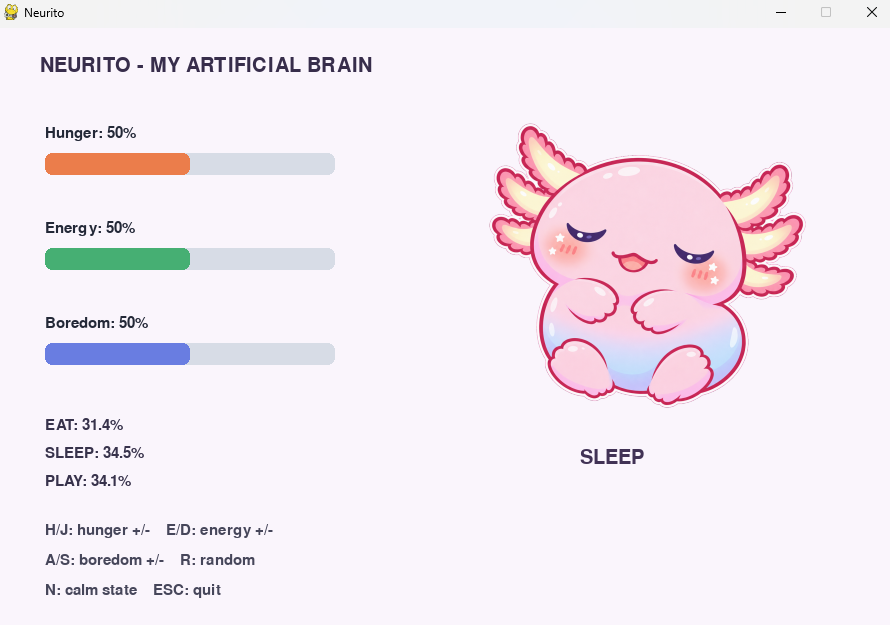

*Nota sobre modificaciones en el código:* Para llevar a cabo estos experimentos, se realizaron alteraciones directas en el archivo `main.py`. Puedes revisar el código fuente en este repositorio para verificar los cambios aplicados en la inicialización de la red neuronal (capa oculta de 10 neuronas) y en el ciclo de entrenamiento (2500 épocas y tasa de aprendizaje de 0.05).

---

## Neurito 2.0: Aprendizaje de Saltos (feature/neurito-salto)
Se integraron los módulos `salto_modelo.py` y `saltar.py` para implementar una red neuronal (3 → 12 → 1) que enseña a Neurito a esquivar obstáculos utilizando aprendizaje supervisado y entropía cruzada binaria.

### Resultados de los Experimentos (Evidencias gráficas):
1. **Línea base (Sin entrenar):** Con pesos inicializados aleatoriamente, el modelo es incapaz de tomar decisiones útiles. Choca con el 100% de los obstáculos. 
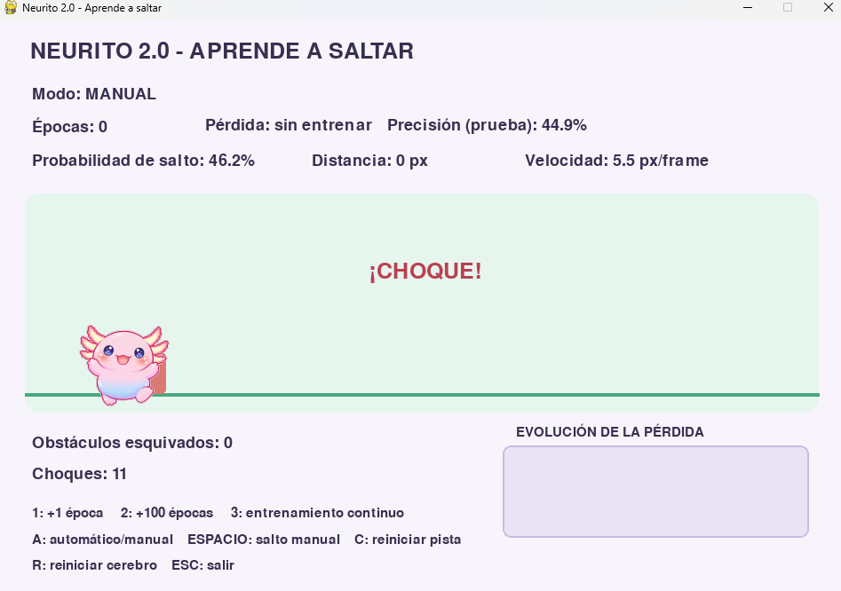

2. **Entrenamiento progresivo:** Al entrenar en bloques de 100 épocas, la pérdida desciende gradualmente y la precisión frente a los datos sintéticos sube. En el entorno gráfico, esto se traduce en saltos oportunos. 
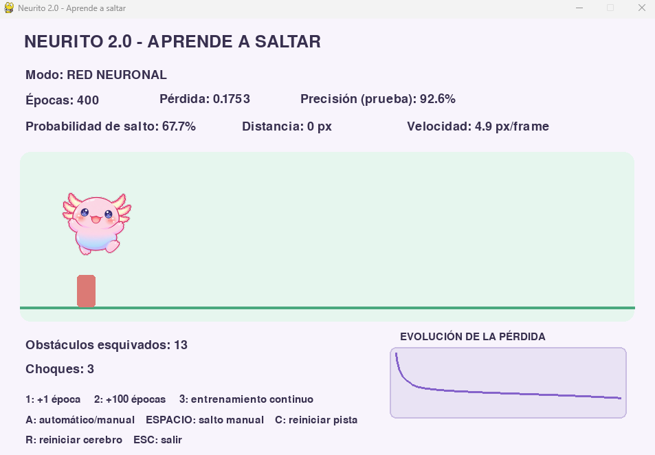

3. **Modificación de la capa oculta:**
  - *3 neuronas:* La red sufre underfitting (baja generalización) y no logra abstraer la relación entre las variables. 
  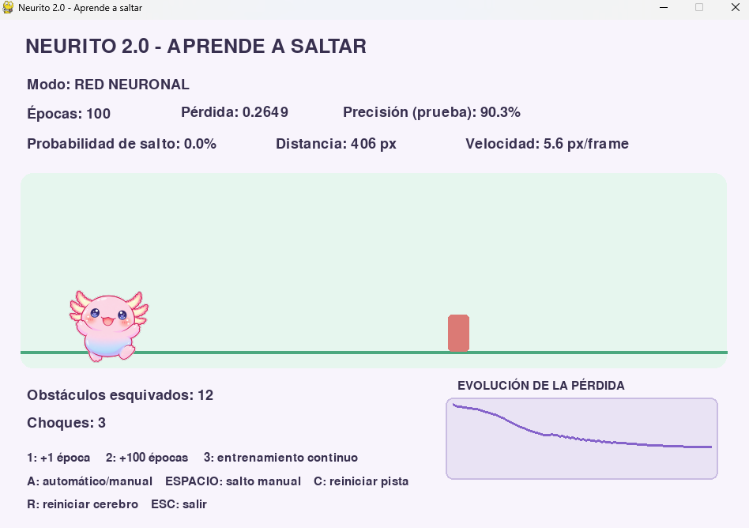
  - *24 neuronas:* La red aprende la regla rápidamente, pero incrementa el cálculo matricial de manera innecesaria. 
  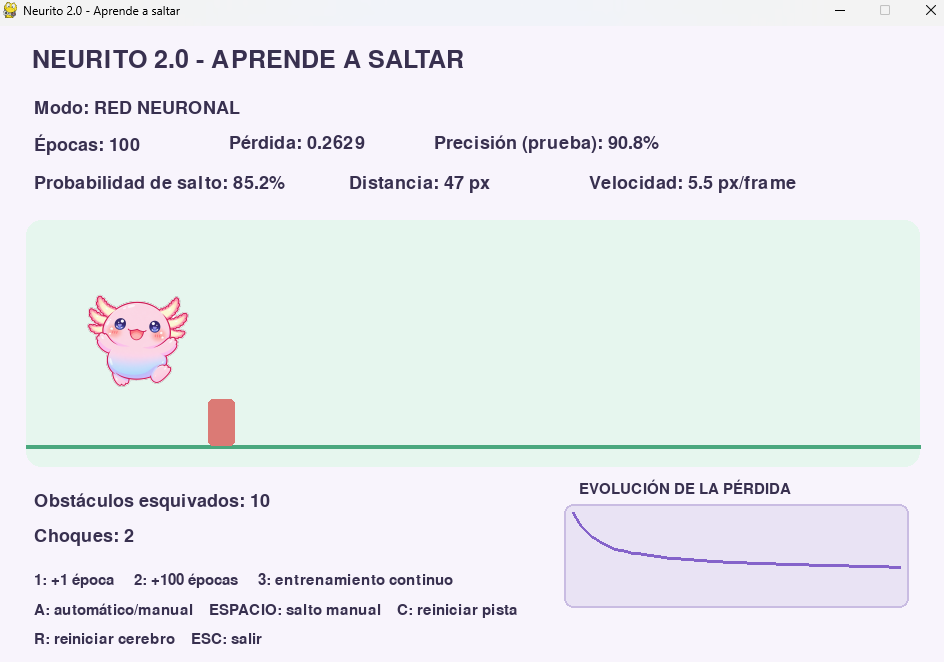

4. **Tasa de aprendizaje (Learning Rate):**
  - *Bajar a 0.01:* La convergencia es demasiado lenta. 
  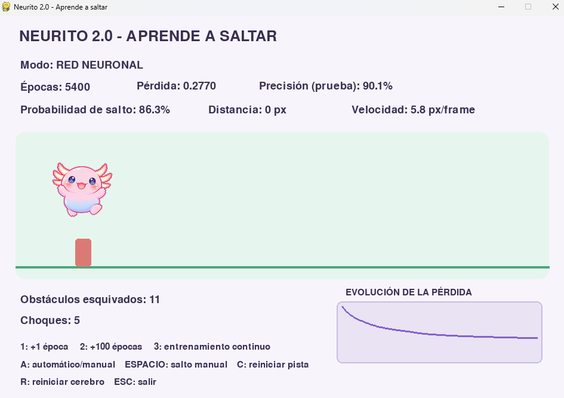
  - *Subir a 1.2:* El entrenamiento se vuelve inestable; la pérdida oscila drásticamente sin encontrar el mínimo. 
  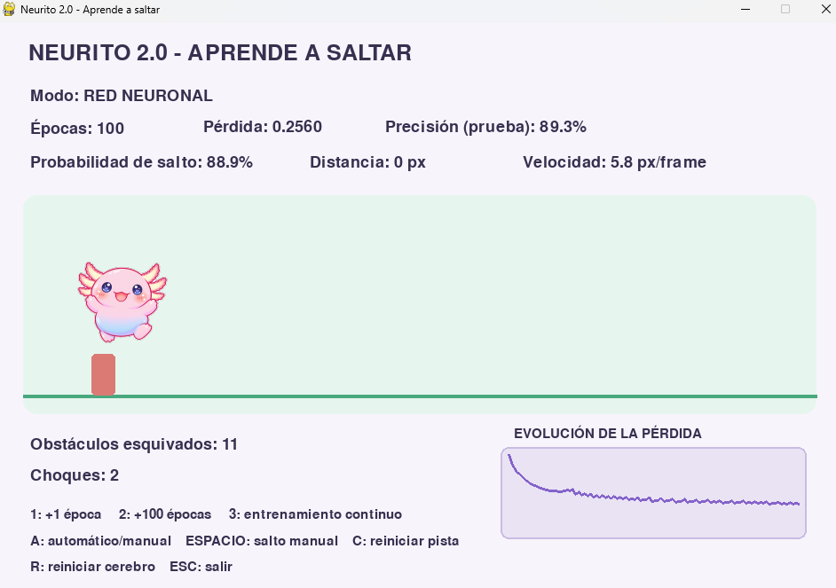

5. **Ventana de entrenamiento:** Al ajustar la etiqueta de salto a un rango tardío (ej. 2 a 5 fotogramas), la red neuronal aprende esta regla con éxito y muestra una precisión alta. Sin embargo, en el juego colisiona constantemente. 
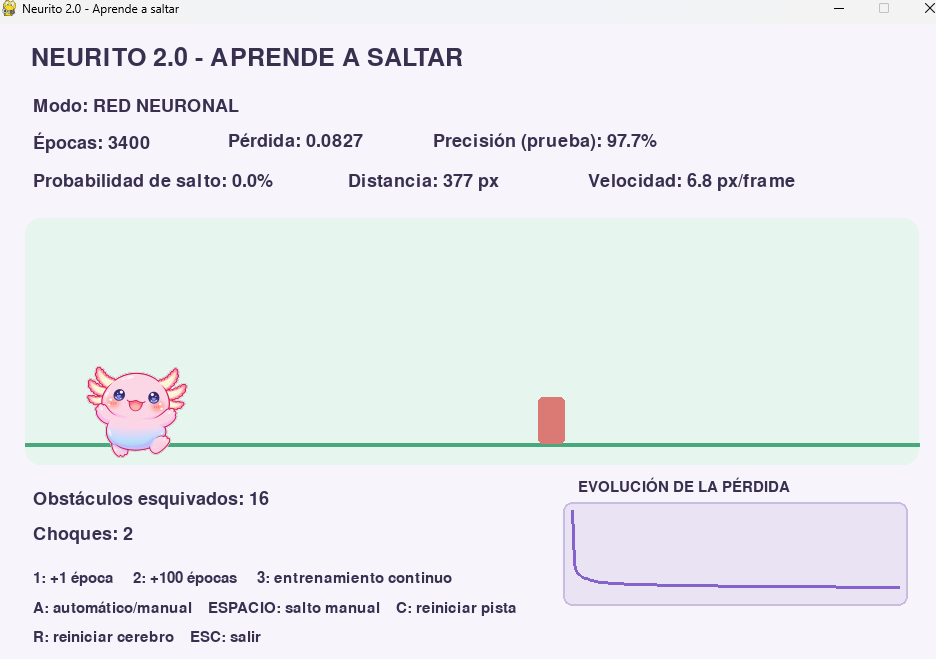

**Pregunta central: ¿Por qué una red puede clasificar ejemplos con buena precisión y aun así chocar?** Porque la precisión mide qué tan bien la red se ajusta a las etiquetas sintéticas provistas durante el entrenamiento, no su rendimiento en el entorno físico. Si la regla matemática (ventana de fotogramas) es incompatible con las leyes del motor de Pygame (gravedad, velocidad de salto e inercia), la red ejecutará la regla a la perfección pero fallará en evitar el obstáculo.

---

## Neurito 3.0: Busca Comida en un Laberinto (feature/neurito-laberinto)

Se implementó un modelo de red neuronal profunda (165 → 96 → 4) que permite a Neurito encontrar comida en laberintos basándose en aprendizaje supervisado por imitación (utilizando algoritmos de búsqueda como "expertos").

### Resultados de los Experimentos

**1. Sin entrenar:**  
Neurito se atasca rápidamente, chocando contra las paredes o entrando en bucles. Esto ocurre porque los pesos aleatorios iniciales suelen favorecer fuertemente una única dirección continua.
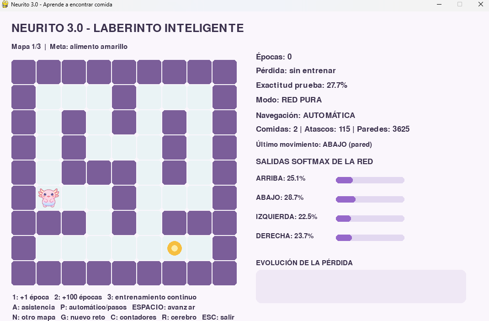

**2. Proceso de entrenamiento (100, 200 y 400 épocas):**  
A medida que aumentan las épocas, la pérdida disminuye y la precisión aumenta. A las 400 épocas, Neurito traza rutas directas y eficientes hacia la meta.
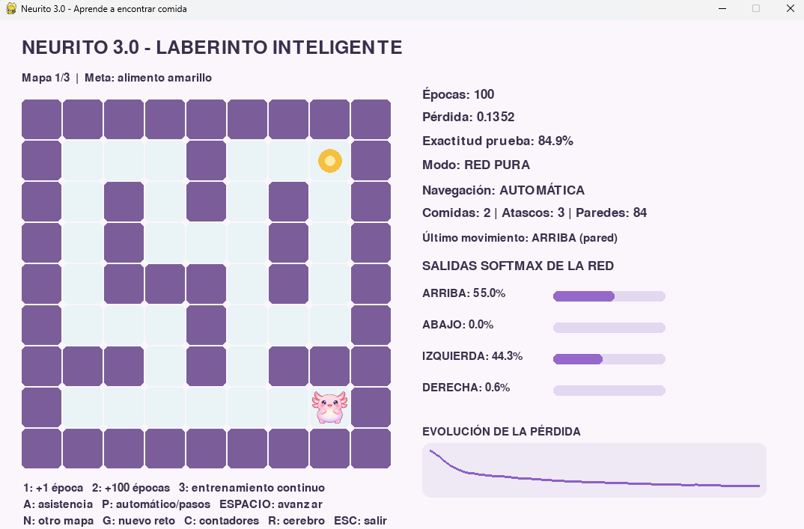
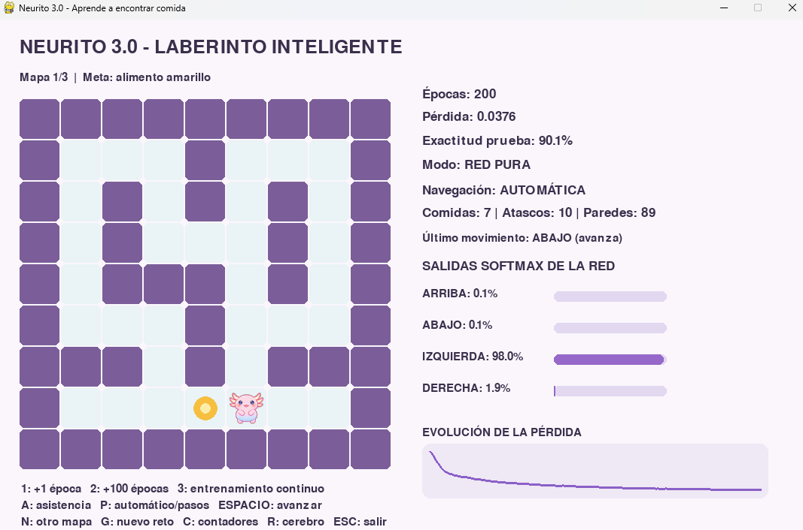
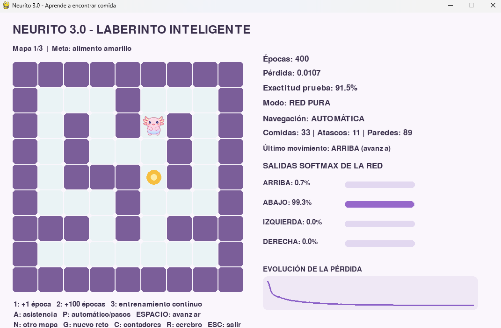

**3. Red pura vs. Navegación asistida:**  
* **Red Pura:** Muestra las decisiones matemáticas exactas de la red; puede chocar si la probabilidad de un movimiento incorrecto es alta.
* **Navegación Asistida:** Descarta movimientos contra las paredes y penaliza repeticiones. Estas son reglas lógicas externas de prevención de colisiones del entorno, no conocimientos interiorizados por el modelo neuronal.
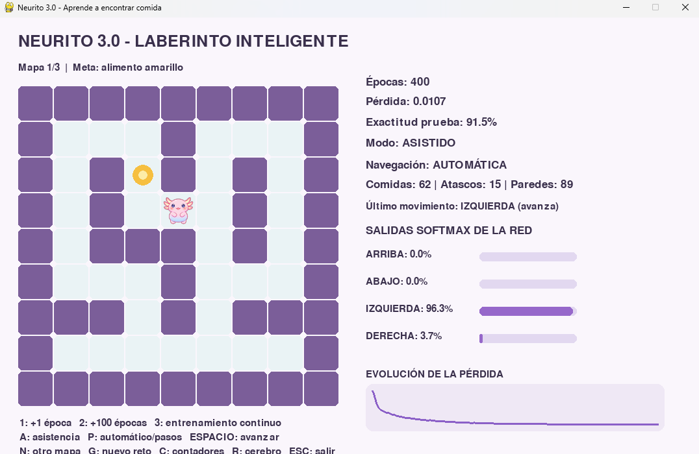

**4. Capas Ocultas (Generalización):**  
Modificaciones realizadas en `laberinto_red.py`:

    # Prueba 1: Underfitting (16 neuronas, le cuesta trazar rutas)
    def __init__(self, semilla=42, ocultas=16, tasa=0.45):

    # Prueba 2: Sobrecapacidad (128 neuronas, innecesariamente costoso)
    def __init__(self, semilla=42, ocultas=128, tasa=0.45):

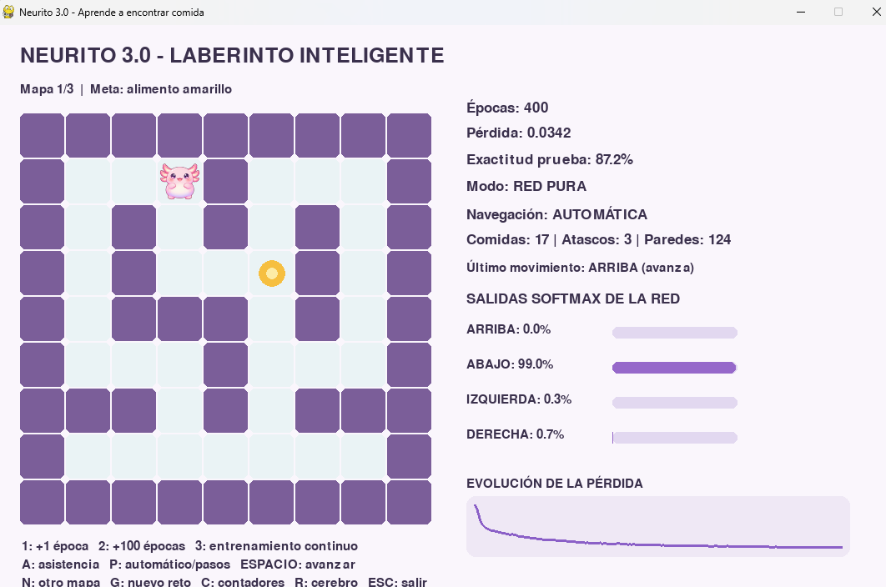
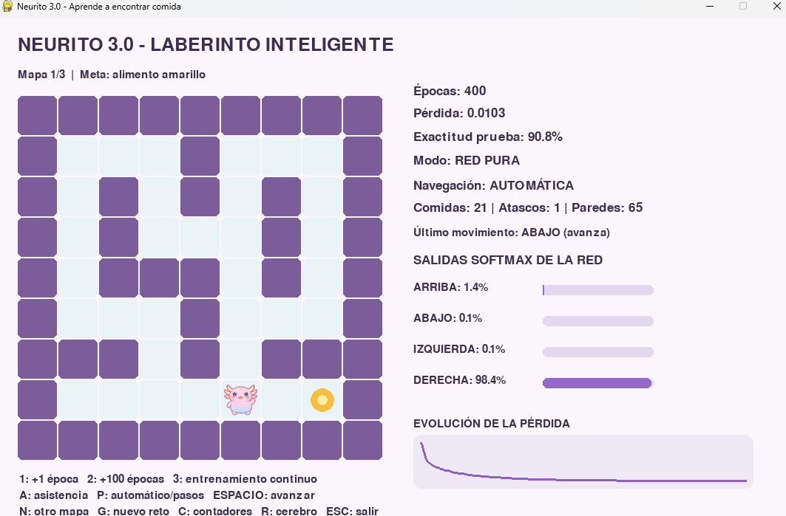

**5. Tasa de Aprendizaje:**  
Modificaciones realizadas en `laberinto_red.py`:

    # Prueba 1: Convergencia muy lenta (Casi no aprende)
    def __init__(self, semilla=42, ocultas=96, tasa=0.01):

    # Prueba 2: Inestabilidad (La pérdida oscila y se rompe)
    def __init__(self, semilla=42, ocultas=96, tasa=1.5):

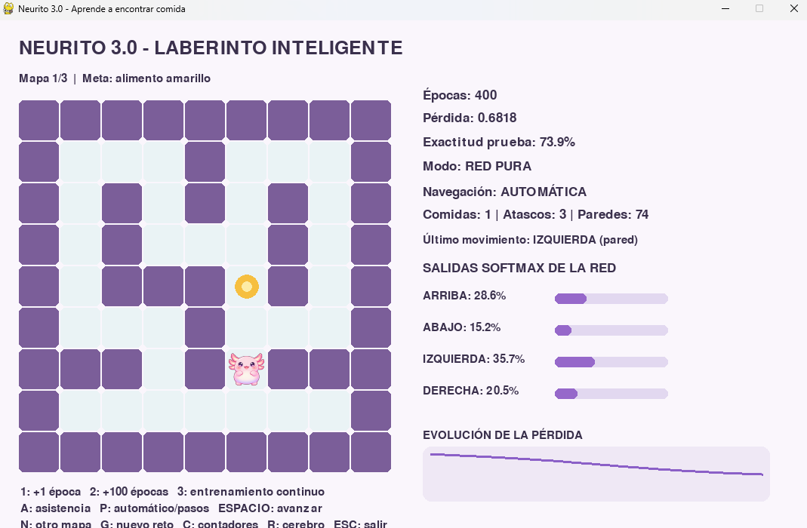
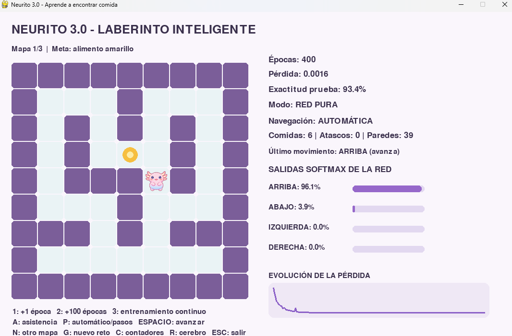

**6. Generalización de Mapas:**  
Neurito logra navegar espacialmente a través de combinaciones de coordenadas (Inicio-Meta) que no vio en el conjunto de entrenamiento, demostrando generalización sobre la topología del mapa.
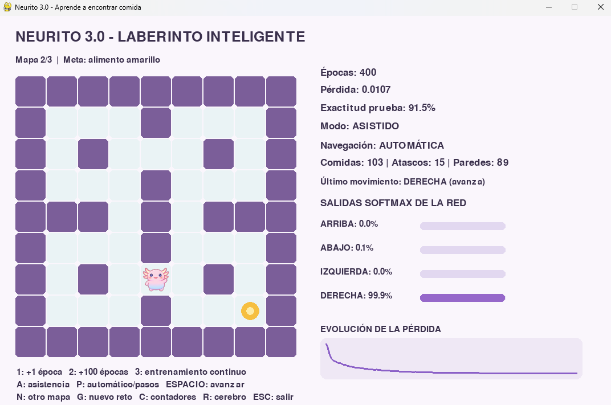

**7. Vibecoding: Cambio de algoritmo Experto (DFS y A*)**  
El modelo aprende por imitación. Si cambiamos al "experto" que genera los datos en `laberinto_mundo.py`, la red hereda sus deficiencias o virtudes:

**Prueba con DFS (Búsqueda en profundidad - Uso de Pila):**  
Al usar una pila, el experto da largos rodeos. La red imitó esta ineficiencia perfectamente tomando caminos absurdos.
    
    def distancias_bfs(mapa, meta):
        dist = {meta: 0}
        pila = [meta]  # Uso de Pila (Stack)
        while pila:
            actual = pila.pop()
            for a in range(4):
                siguiente = vecino(actual, a)
                if valido(mapa, siguiente) and siguiente not in dist:
                    dist[siguiente] = dist[actual] + 1
                    pila.append(siguiente)
        return dist

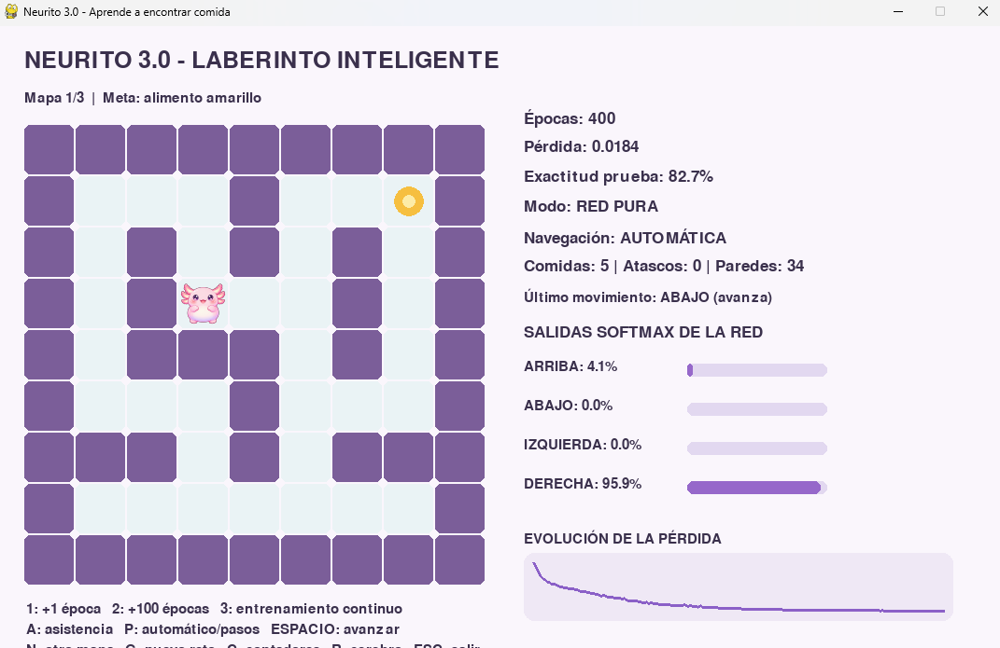

**Prueba con A* / Dijkstra (Cola de prioridad):**  
Al usar `heapq`, el experto optimiza las rutas radialmente desde la meta. La red aprendió movimientos totalmente eficientes.

    def distancias_bfs(mapa, meta):
        import heapq
        dist = {meta: 0}
        pq = [(0, meta)] # Uso de Cola de Prioridad
        while pq:
            d, actual = heapq.heappop(pq)
            if d > dist.get(actual, float('inf')): continue
            for a in range(4):
                siguiente = vecino(actual, a)
                if valido(mapa, siguiente):
                    nueva_d = d + 1
                    if nueva_d < dist.get(siguiente, float('inf')):
                        dist[siguiente] = nueva_d
                        heapq.heappush(pq, (nueva_d, siguiente))
        return dist

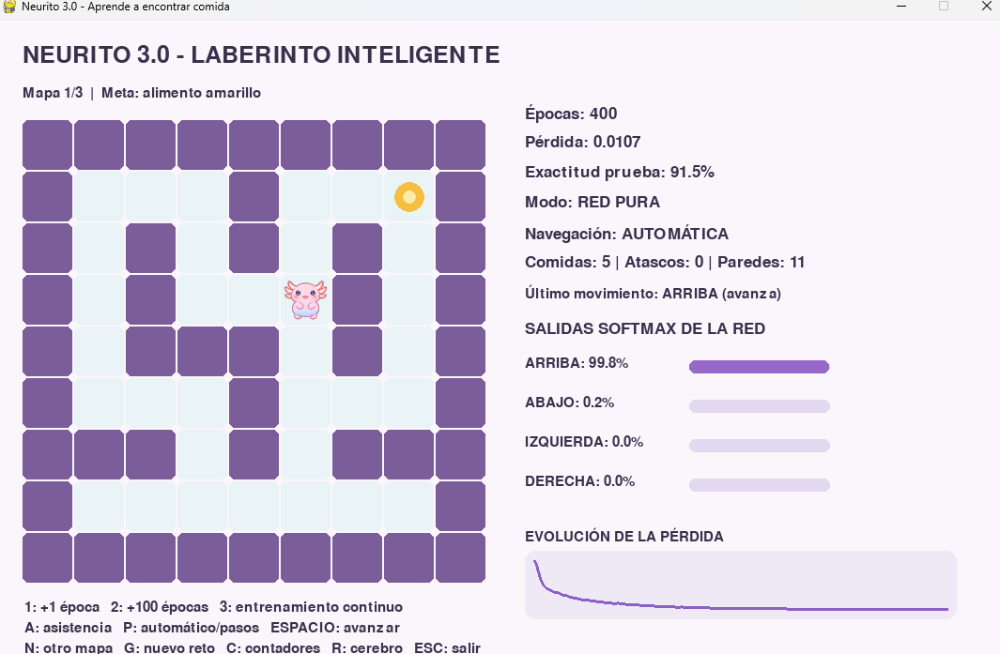

**8. Pruebas Automáticas:**  
Los test unitarios pasaron exitosamente confirmando la integridad estructural de la red del laberinto.
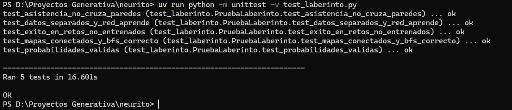